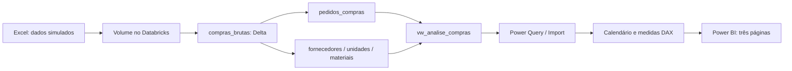

# Compras de embalagens — análise de custos e fornecedores

Projeto de portfólio que conecta preparação de dados em SQL no Databricks à análise de compras no Power BI. O objetivo é comparar fornecedores considerando **preço, frete e confiabilidade das entregas**, sem confundir o menor preço de compra com o menor custo por peça aceita.

> Estudo independente com dados fictícios, inspirado no contexto de compras de embalagens da indústria de bebidas. Não representa dados, resultados ou um projeto contratado pela Solar Coca-Cola. Os padrões dos fornecedores fazem parte da simulação.

## Problema de negócio

Uma escolha baseada apenas no preço unitário pode ignorar o peso do frete e o risco de entregas atrasadas ou incompletas. O relatório permite investigar:

- Quanto foi gasto e qual a participação do frete?
- Quais fornecedores entregam no prazo e na quantidade contratada?
- Como o frete altera a comparação de custos dentro de um mesmo material?
- Quais alternativas merecem uma análise comercial mais detalhada?

## Escopo e resultados da base simulada

Pedidos emitidos entre janeiro e dezembro de 2025: **1.080 pedidos, 5 fornecedores, 3 materiais e 3 unidades**. Cada linha representa um pedido de um material, com um recebimento consolidado.

| Indicador | Resultado sem filtros |
|---|---:|
| Custo total considerado | R$ 23.332.772,37 |
| Valor líquido dos materiais | R$ 21.192.603,30 |
| Frete total | R$ 2.140.169,07 |
| Participação do frete | 9,17% |
| Pedidos no prazo | 822 / 1.080 — 76,11% |
| Pedidos OTIF | 770 / 1.080 — 71,30% |

Na comparação de preformas PET de 28 g, Alfa apresenta o menor preço de material, mas o maior custo por peça após o frete. Gama apresenta o menor custo por peça e OTIF de apenas 44,68%. Beta combina custo próximo ao menor com OTIF de 79,31%. Essas diferenças orientam investigação; não comprovam economia nem justificam automaticamente uma troca de fornecedor.

## Arquitetura



Tecnologias: Excel como fonte, Databricks SQL e tabelas Delta para preparação, Power Query para tipagem, DAX para medidas e Power BI para apresentação. Python é utilizado apenas para uma conferência independente da base; não integra o fluxo original do dashboard.

## Páginas do relatório

1. **Visão geral:** indicadores de custo e serviço, desempenho por fornecedor e evolução mensal.
2. **Custos e fornecedores:** matriz por material e fornecedor com pedidos, preço, frete, custo por peça e OTIF.
3. **Oportunidades de compras:** composição do custo por peça e dispersão de custo × OTIF, comparando um material por vez.

Os filtros contemplam material, unidade, tipo de compra e data de emissão do pedido. O período representa a emissão, não o mês do recebimento.

## Documentação

| Documento | Conteúdo |
|---|---|
| [Análise de negócio](docs/NEGOCIO.md) | Perguntas, indicadores, achados, decisões e limites |
| [Documentação técnica](docs/TECNICA.md) | Arquitetura, modelagem, regras e manutenção |
| [Dicionário de dados](docs/DICIONARIO.md) | Campos de origem e derivados |
| [Reprodução e validação](docs/REPRODUCAO.md) | Como reconstruir e conferir o projeto |
| [Referência DAX](powerbi/REFERENCIA_DAX.md) | Medidas e colunas discutidas no desenvolvimento |
| [SQL de referência](sql/README.md) | Preparação, validação e análises reconstruídas |
| [Evidências e pendências](docs/EVIDENCIAS.md) | O que foi conferido e o que depende de exportação |

## Como usar o projeto

O repositório inclui o [dashboard Power BI](powerbi/analise-compras.pbix), a [base simulada](data/Base_Compras_Embalagens_Simulada.xlsx), os scripts SQL, a referência DAX e a documentação.

Abra o PBIX no Power BI Desktop para explorar o relatório com os dados importados. A fonte do dashboard é a view `workspace.compras_embalagens.vw_analise_compras` no **Databricks**. Para atualizar os dados ou reconstruir o ambiente, configure sua própria conexão e autenticação seguindo o [guia de reprodução](docs/REPRODUCAO.md). A planilha é a origem da carga no Databricks; ela não substitui a conexão do dashboard.

Para conferir a base local, execute na raiz do repositório:

```bash
python -m pip install -r requirements.txt
python validar_base.py "data/Base_Compras_Embalagens_Simulada.xlsx"
```

O script [validar_base.py](validar_base.py) recalcula os indicadores diretamente do Excel; o resultado está em [validacao.json](validacao.json). O custo por peça global nesse JSON é um cálculo diagnóstico, não um indicador recomendado para comparar materiais diferentes.

## Organização do repositório

```text
README.md
.gitignore
.gitattributes
data/          # Base Excel simulada
powerbi/       # Dashboard PBIX e referência DAX
sql/           # Preparação, validação e análises no Databricks
docs/          # Negócio, técnica, dicionário, reprodução e evidências
assets/        # Orientações para acrescentar capturas do dashboard
validar_base.py
validacao.json
requirements.txt
```

As capturas finais das três páginas ainda não estão incluídas. Veja as [orientações para adicioná-las](assets/README.md).

## Limitações

Sem estoque, consumo, impostos, capacidade de fornecimento ou custo financeiro modelados. Não há previsão de demanda, otimização de compras, economia realizada ou implantação em produção. A carga é estática; atualização incremental e agendamento não fazem parte do escopo documentado.

Documentação inicial preparada em 24/09/2026; organização para publicação revisada em 20/10/2026. Os scripts SQL e DAX de referência precisam ser confrontados com as exportações originais antes de serem apresentados como cópia exata da implementação.
