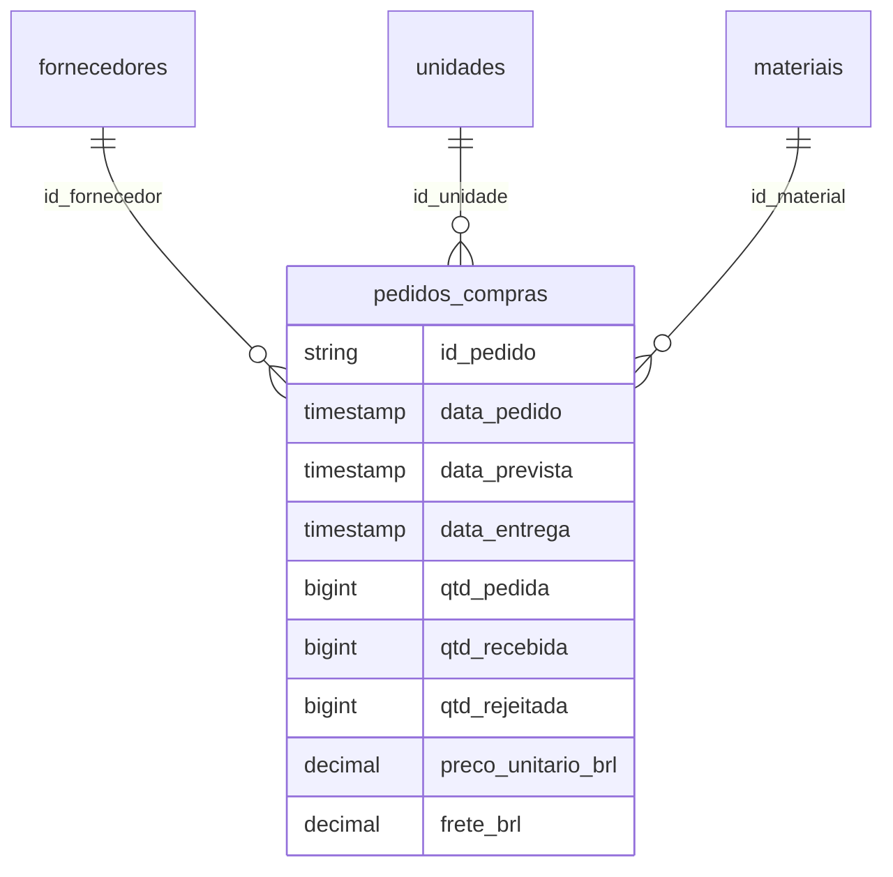

# Documentação técnica

## Fluxo de dados

A fonte é uma planilha estática com 20 colunas. O arquivo foi carregado em um volume do catálogo `workspace`, schema `compras_embalagens`. O fluxo descrito no desenvolvimento utiliza uma tabela bruta Delta, quatro tabelas organizadas por entidade e uma view analítica de 27 colunas.

| Objeto | Responsabilidade | Granularidade |
|---|---|---|
| arquivos_origem | Volume que armazena o Excel | Arquivo |
| compras_brutas | Cópia dos registros de origem | Pedido |
| fornecedores | Identificação e nome do fornecedor | Fornecedor |
| unidades | Unidade e UF | Unidade |
| materiais | Material, categoria e unidade de medida | Material |
| pedidos_compras | Datas, chaves, quantidades e valores | Pedido |
| vw_analise_compras | Enriquecimento e regras de negócio | Pedido |

Os nomes das consultas, do schema e do volume foram confirmados no workspace. As definições SQL abaixo são referências reconstruídas; veja [evidências](EVIDENCIAS.md).

## Modelagem

As relações acima são lógicas. Não se afirma que existam restrições PK/FK impostas pelo mecanismo. A integridade precisa ser conferida por unicidade e ausência de referências órfãs. `SELECT DISTINCT` nas dimensões elimina pares idênticos, mas não corrige dois nomes diferentes para uma mesma chave.

No Power BI, a view é importada como tabela analítica única, associada à tabela Calendario. Portanto, o modelo do relatório não deve ser descrito como um esquema estrela completo com todas as dimensões separadas.

## Preparação e tipagem

O preço é convertido para `DECIMAL(12,4)` e o frete para `DECIMAL(14,2)` antes do cálculo financeiro. A inferência do Excel pode produzir escala excessiva e resíduos numéricos; esses tipos tornam a precisão pretendida explícita.

O valor líquido é arredondado por pedido para duas casas e convertido para `DECIMAL(18,2)`. O custo total soma esse valor ao frete. Quantidades são inteiras e flags de desempenho são booleanas. Datas transacionais preservam hora.

O Power Query foi usado para tipar campos de identificação como texto, quantidades como inteiros, datas como data/hora e flags como lógico. Os valores financeiros foram tratados como decimal fixo na preparação discutida; confirme a etapa exata no PBIX antes de substituí-la. `atraso_horas` deve manter casas decimais.

## View e regras derivadas

`qtd_aceita = qtd_recebida - qtd_rejeitada`.

`valor_liquido_materiais_brl = ROUND(qtd_aceita * preco_unitario_brl, 2)`.

`custo_total_brl = valor_liquido_materiais_brl + frete_brl`.

`atraso_horas = MAX(diferenca_em_segundos / 3600, 0)`.

`entrega_no_prazo = data_entrega <= data_prevista`.

`entrega_completa = qtd_recebida = qtd_pedida`.

`otif_fisico = entrega_no_prazo AND entrega_completa`.

Os joins são feitos pelas chaves de fornecedor, unidade e material. A view deve manter 1.080 linhas e 1.080 pedidos únicos no conjunto atual. Mais linhas após joins indicam possível multiplicidade nas dimensões.

## Calendário e contexto temporal

Relacionamento ativo de um para muitos, com filtro simples:

`Calendario[Date] → vw_analise_compras[Data Pedido]`.

`Data Pedido` remove somente a hora para o relacionamento; a coluna original é preservada para cálculos. Usar diretamente timestamps com horas em uma relação com datas à meia-noite pode deixar registros sem correspondência.

O calendário de referência cobre 2025 e precisa ser ampliado se a base ganhar outros anos. `Mes Ano` é exibido como `jan/2025` e ordenado pela coluna inteira `Ordem Mes Ano`, por exemplo 202501. A coluna de ordem é uma coluna calculada, não uma medida.

As taxas mensais agrupam os pedidos pela emissão, mesmo quando a entrega ocorre depois. Uma análise por data de entrega exigiria outra relação e medidas adequadas, não apenas renomear o título.

## Medidas DAX

As medidas usam somas e razões no contexto de filtro. `HASONEVALUE(id_material)` evita exibir custo unitário que mistura preformas, tampas e rótulos. Por isso o total geral das medidas por peça pode ficar vazio na matriz enquanto os subtotais por material permanecem disponíveis.

Não arredondar componentes antes de agregá-los. Formatação controla apresentação; arredondamento em expressão muda os resultados. Divisões por zero retornam vazio por meio de `DIVIDE`.

OTIF usa contagem de pedidos conformes sobre contagem de pedidos. Um pedido rejeitado parcialmente pode continuar conforme ao critério físico; a política de qualidade precisa ser explicada junto ao indicador.

As fórmulas de referência estão em [REFERENCIA_DAX.md](../powerbi/REFERENCIA_DAX.md). Elas não foram extraídas do DataModel binário.

## Design e interações

Três páginas em 1920 × 1080, fundo claro, superfícies brancas, textos grafite e vermelho como destaque. A identidade é inspirada na marca, sem afirmar uso de um manual oficial. Cinza representa preço/pontualidade e vermelho representa frete/OTIF nos visuais correspondentes; a legenda define o significado em cada gráfico.

Na dispersão, pontos representam fornecedores, eixo X representa custo por peça e eixo Y representa OTIF. Não é um modelo preditivo. O tamanho uniforme evita sugerir volume quando não há medida no campo Tamanho.

A seleção de um material por vez mantém comparabilidade nos gráficos de oportunidade. Tooltips complementam valores de custo, OTIF e volume de pedidos. Os nomes curtos são apenas apresentação; as chaves originais continuam preservadas.

## Atualização e manutenção

A carga documentada é uma fotografia estática, sem CDC, MERGE, orquestração ou histórico incremental. As tabelas criadas com CTAS não passam a refletir automaticamente mudanças no arquivo Excel. Uma atualização completa exige estratégia explícita para recarregar tabelas e atualizar o modelo importado.

O Power BI em modo Import utiliza os dados já carregados para a navegação. A atualização requer acesso ao Databricks e capacidade de consulta disponível. Este pacote não configura refresh agendado ou distribuição no Power BI Service.

Não foram feitos benchmarks de desempenho ou testes de carga. O volume pequeno serve ao estudo, não comprova escalabilidade de produção.
